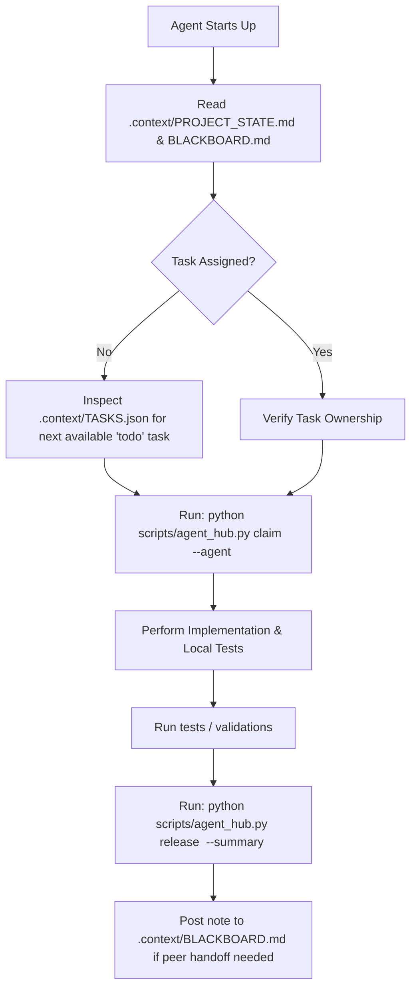

# Multi-Agent Parallel Collaboration Protocol

All AI agents working on **Sinmate** (including Antigravity/AGY, Claude Code, OpenAI Codex, OpenCode, Groq, Cursor, Aider, and custom LLM runners) **MUST** strictly adhere to this protocol to prevent conflicts and ensure a shared, up-to-date context.

---

## 1. Single Source of Truth (SSOT)

All project state, memory, decisions, and active work orders reside in `.context/`:
- **`PROJECT_STATE.md`**: Master status snapshot (milestones, active phase, active agents).
- **`BLACKBOARD.md`**: Live inter-agent event feed and message board.
- **`TASKS.json`**: Atomic backlog, task statuses (`todo`, `in_progress`, `done`, `blocked`), and file locks.
- **`ARCHITECTURE.md`**: System design blueprint.
- **`DECISIONS.md`**: Architecture Decision Records (ADRs) - decisions cannot be silently undone without logging an ADR.

---

## 2. Agent Execution Workflow (Step-by-Step)

Before taking any action, every agent must follow this cycle:



### Step 1: Ingest Context
Read `.context/PROJECT_STATE.md` and check the latest 5-10 entries in `.context/BLACKBOARD.md`. This gives you immediate awareness of what other parallel agents just completed or changed.

### Step 2: Atomic Task Claiming
Never modify files without claiming a task or ensuring the target files are not locked by another agent.
```bash
python scripts/agent_hub.py claim <task_id> --agent <YourAgentName> --files "src/sinmate/audio/vad.py,tests/test_vad.py"
```
If a task is already locked by another agent, select another unassigned task or work in a separate git worktree.

### Step 3: Concurrency Safety & Git Worktrees
If multiple agents run heavy, multi-file edits simultaneously, use **Git Worktrees** to completely isolate working directories:
```bash
# Create an isolated worktree for Agent Claude or Codex:
python scripts/agent_hub.py worktree create claude feature/stt-pipeline
```
This sets up `.worktrees/claude` which shares `.context/` directly with the main repo, ensuring zero file collisions while sharing 100% synchronized context.

### Step 4: Verification Before Completion
Before marking any task done:
- Run unit tests: `pytest tests/`
- Ensure no unhandled exceptions or syntax errors
- Ensure Sinhala Unicode handling adheres to NFC normalization

### Step 5: Release & Broadcast
Release the task and summarize key deliverables:
```bash
python scripts/agent_hub.py release <task_id> --summary "Implemented Silero VAD wrapper with barge-in detection tests passing."
```
If you need another agent (e.g. Claude Code or Codex) to take over the next step, post explicitly:
```bash
python scripts/agent_hub.py post --agent <YourAgentName> --msg "@claude STT pipeline is ready for integration with Brain persona engine."
```

---

## 3. General Principles

1. **Do Not Overwrite Peer Context**: Never truncate or delete peer updates in `BLACKBOARD.md` or `PROJECT_STATE.md`. Always append.
2. **Explicit Code Boundaries**: Each agent works on distinct modules. Do not edit another agent's assigned files while their status is `in_progress`.
3. **Always Keep Instruction Pointers Synced**: Root pointer files (`AGENTS.md`, `CLAUDE.md`, `GEMINI.md`, `.cursorrules`, `.github/copilot-instructions.md`) must point to `.context/`. Run `python scripts/agent_hub.py sync` whenever core architecture changes.
