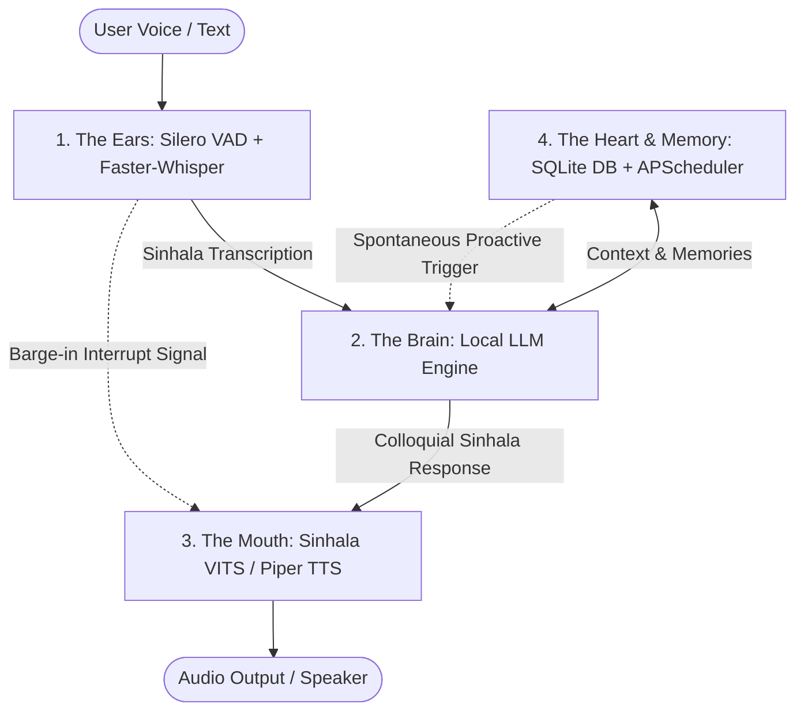

# Sinmate Architecture Specification

> **Project Mission**: A lightweight, locally runnable native Sinhala AI companion that talks, listens, remembers, and spontaneously initiates conversation like a real friend, family member, partner, or teacher. Designed to run offline on a laptop/desktop within 4 GB - 6 GB of RAM/VRAM.

---

## 1. System Overview: The 4-Part Modular Companion

Instead of one monolithic giant model, Sinmate runs 4 lightweight local subsystems side-by-side:



| Subsystem | Technical Component | Recommended Models / Tools | VRAM/RAM Target |
| :--- | :--- | :--- | :--- |
| **1. The Ears** | Silero VAD + Faster-Whisper | `snakers4/silero-vad` + `SinhaSpeech/whisper-small-sinhala-run11` | ~400 MB - 600 MB |
| **2. The Brain** | Local LLM Engine (4-bit GGUF via Ollama / llama.cpp) | `google/gemma-3-4b-it` or `google/gemma-2-2b-it` (or `singemma`) | ~1.6 GB - 2.8 GB |
| **3. The Mouth** | Local Neural TTS (VITS / Piper) | `dialoglk/SinhalaVITS-TTS-F1` or `SafnasKaldeen/Sinhala-Text-to-Speech-VITS` | ~200 MB - 350 MB |
| **4. The Heart & Memory** | Async Event Loop + Local SQLite + APScheduler | SQLite fact/chat store + APScheduler background heartbeat timer | < 100 MB |

---

## 2. Core Behavioral Mechanics

### A. Spontaneous Proactive Heartbeat
Traditional chatbots wait silently. Sinmate uses a background heartbeat loop (15-30 min intervals) tracking:
- Current local time
- User silence duration
- Historical memories / pending topics
- Generates proactive greetings (e.g., at 11:30 PM: *"ඒයි, දැන් රෑ 11:30 යි නේද? තාම වැඩද? පොඩ්ඩක් ඇස්දෙකට නිවාඩුවක් දෙන්න."*)

### B. Natural Spoken Colloquial Sinhala (Kathitha Bhashawa)
Avoids stiff textbook grammar (*Likhitha Bhashawa*) and robotic translationese.
- Outputs 1-2 short spoken sentences per turn.
- Uses natural Sri Lankan conversational fillers (*"හ්ම්ම්..."*, *"ආ ඇත්තද?"*, *"ඉතින් කියන්නකෝ"*, *"හරි හරි"*).

### C. Dynamic Multi-Persona System
Single model configured via dynamic role markers:
- `[ROLE: BEST_FRIEND]`: Casual, humorous, supportive, uses friendly colloquial phrasing.
- `[ROLE: SPECIAL_PARTNER]`: Warm, caring, emotionally attentive, affectionate tone.
- `[ROLE: MOTHER_FIGURE]`: Nurturing, protective, asks about meals/rest, gentle guidance.
- `[ROLE: TEACHER]`: Encouraging, patient, structured explanations, asks follow-up questions.

### D. Full-Duplex Barge-In (Interruptibility)
When the user speaks while TTS playback is active:
- Silero VAD detects user voice within 30ms.
- Immediately signals audio playback to halt and routes the incoming speech to STT.

---

## 3. Directory Layout

```
Sinmate/
├── .context/                  # Shared Multi-Agent Nerve Center (SSOT)
│   ├── PROJECT_STATE.md       # High-level state & progress
│   ├── BLACKBOARD.md          # Live agent message & event log
│   ├── TASKS.json             # Atomic task board & locks
│   ├── ARCHITECTURE.md        # This specification file
│   ├── DECISIONS.md           # Architecture Decision Records (ADRs)
│   └── AGENT_PROTOCOL.md      # Operating rules for parallel agents
├── docs/                      # Reference manuals & research documents
│   └── Training a Native Sinhala AI Model.pdf
├── src/
│   └── sinmate/
│       ├── __init__.py
│       ├── audio/             # VAD, STT, and audio stream handling
│       │   ├── __init__.py
│       │   ├── vad.py         # Silero VAD wrapper
│       │   ├── stt.py         # Faster-Whisper Sinhala transcriber
│       │   └── player.py      # Audio playback & barge-in controller
│       ├── brain/             # LLM orchestration & personas
│       │   ├── __init__.py
│       │   ├── llm_engine.py  # Local LLM client (Ollama / GGUF)
│       │   ├── personas.py    # Multi-persona prompt templates
│       │   └── normalizer.py  # Unicode NFC & Sinhala text cleaning
│       ├── tts/               # Voice synthesis engine
│       │   ├── __init__.py
│       │   └── vits_tts.py    # VITS / Piper Sinhala TTS integration
│       ├── memory/            # Persistent memory & fact store
│       │   ├── __init__.py
│       │   └── db.py          # SQLite schema & memory retrieval
│       └── proactive/         # Spontaneous heartbeat loop
│           ├── __init__.py
│           └── heartbeat.py   # Background scheduler & event triggers
├── notebooks/                 # Google Colab notebooks for training & benchmarks
│   └── 01_colab_sinhala_tokenizer_benchmark.ipynb
├── scripts/                   # Tooling, evaluation & agent sync
│   ├── agent_hub.py           # Multi-agent orchestrator & state manager
│   ├── evaluate_tokenizer.py  # Sinhala tokenizer fertility evaluator
│   └── sync_context.py        # Synchronizer for CLAUDE/GEMINI/AGENTS files
├── tests/                     # Automated unit and integration test suite
├── agent                      # Universal POSIX executable launcher (macOS / Linux / Colab)
├── agent.bat                  # Windows CMD launcher
├── agent.ps1                  # Windows PowerShell launcher
├── .cursorrules               # Cursor IDE agent instructions
├── AGENTS.md                  # Universal / Codex / OpenCode agent instructions
├── CLAUDE.md                  # Anthropic Claude Code agent instructions
├── GEMINI.md                  # Google Antigravity / Gemini agent instructions
├── requirements-colab.txt     # Colab GPU dependencies (Unsloth, bitsandbytes, PEFT)
├── pyproject.toml             # Project configuration and dependencies
└── README.md                  # Getting started & environment guide
```

---

## 4. Hybrid Infrastructure: Google Colab & Cross-Platform Clients

Due to local hardware constraints when running or fine-tuning models like Gemma 3:
1. **Google Colab (Compute Engine - Free T4 / Cloud GPUs)**:
   - Used for heavy tasks: Sinhala tokenizer fertility evaluation, synthetic dataset curation, QLoRA SFT training, DPO preference alignment, and 4-bit GGUF quantization export.
   - Notebooks reside in `notebooks/` with Colab-optimized dependencies in `requirements-colab.txt`.
2. **Mac & Windows Client Development**:
   - Code development, voice loop integration, and testing happen on developer laptops (macOS and Windows).
   - Zero Windows lock-in: Universal POSIX `./agent` shell script for macOS and Linux; `agent.bat`/`agent.ps1` for Windows; all core tooling in cross-platform Python.
   - Once trained on Colab, quantized 4-bit GGUF models (~700MB - 1.8GB) run efficiently on consumer CPU/MPS via Ollama / llama.cpp.

