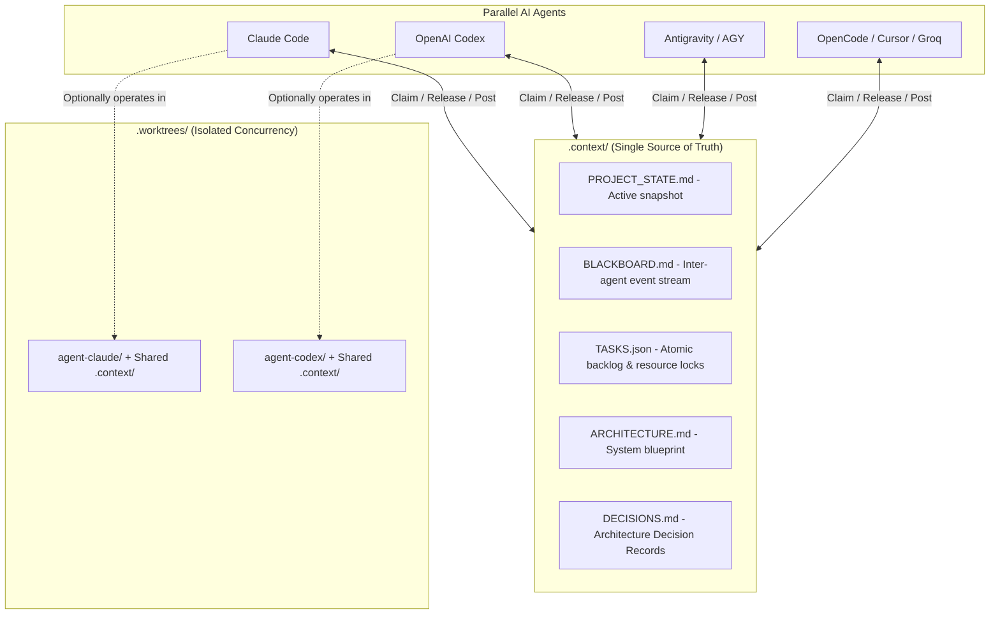

# Sinmate 🇱🇰

> **Edge-Deployable Native Sinhala Conversational Voice Companion**  
> A lightweight, locally runnable AI companion that talks, listens, remembers you, and spontaneously initiates conversation like a real friend, partner, family member, or teacher. Runs within **4 GB – 6 GB RAM/VRAM** on standard laptops.

---

## 🤖 Multi-Agent Parallel Architecture

This project is configured with a **Multi-Agent Coordination Hub** designed specifically for parallel execution across heterogeneous AI agents:
- **Claude Code / Anthropic Claude** (`CLAUDE.md`)
- **OpenAI Codex / Copilot** (`AGENTS.md`, `.github/copilot-instructions.md`)
- **Antigravity / Gemini CLI** (`GEMINI.md`)
- **OpenCode / OpenDevin / Roo / Cline / Cursor** (`AGENTS.md`, `.cursorrules`, `CONVENTIONS.md`)
- **Groq & Custom Autonomous Agents**

All agents share the **exact same live context** and adhere to concurrency locking to avoid file collisions or redundant work.



---

## ⚡ Cross-Platform Agent CLI Quickstart

The agent orchestrator works identically on **macOS**, **Linux**, **Windows**, and inside **Google Colab**:

```bash
# On macOS / Linux / Colab:
./agent status
./agent claim TASK-002 --agent claude
./agent release TASK-002 --summary "Ported fertility script to Colab notebook."
./agent post --agent codex --msg "Ready for next step."
./agent sync

# On Windows:
.\agent.ps1 status    # (PowerShell)
agent.bat status      # (Command Prompt)

# Direct Universal Python (Any platform):
python scripts/agent_hub.py status
```

### 1. Check Global Status & Active Locks
```bash
./agent status
```

### 2. Claim a Task Before Editing Files
```bash
./agent claim TASK-003 --agent claude --files "src/sinmate/audio/vad.py,tests/test_vad.py"
```

### 3. Release a Task Upon Completion
```bash
./agent release TASK-003 --summary "Implemented Silero VAD wrapper with unit tests passing."
```

### 4. Post Messages or Handoffs to Peer Agents
```bash
./agent post --agent codex --msg "@claude VAD is verified. You can now connect STT to the pipeline."
```

### 5. Synchronize All Agent Instruction Files
```bash
./agent sync
```
*(Automatically ensures `AGENTS.md`, `CLAUDE.md`, `GEMINI.md`, `.cursorrules`, and Copilot files reflect the latest context).*

### 6. Run Agents in Parallel Git Worktrees (Zero Clashes)
When multiple agents make deep modifications simultaneously:
```bash
# On macOS / Linux:
./agent worktree create claude feature/stt-pipeline

# On Windows:
.\agent.ps1 worktree create claude feature/stt-pipeline
```
*(Creates an isolated worktree at `.worktrees/claude` with `.context/` symlinked/junctioned in real-time).*

---

## ☁️ Google Colab Workflow (Model Training & Benchmarking)

Because local developer machines (Mac laptops and Windows PCs) may lack sufficient GPU VRAM to run or fine-tune Gemma 3, all compute-heavy workloads are executed in **Google Colab** (Free T4 or Cloud GPUs):

1. **Jupyter Notebooks**: Located in [`notebooks/`](file:///D:/Sinmate/notebooks), ready for one-click opening in Colab.
2. **Colab Dependencies**: Listed in [`requirements-colab.txt`](file:///D:/Sinmate/requirements-colab.txt) (Unsloth, bitsandbytes, PEFT, TRL, Accelerate).
3. **Training & Quantization Pipeline**:
   - Tokenizer fertility tests on Gemma-2B/3-4B vs Qwen vs SinLlama.
   - SFT + DPO training via QLoRA.
   - Quantize final checkpoint to 4-bit GGUF (~700MB - 1.8GB) for offline local execution on Mac/PC.

.\agent.ps1 worktree create claude feature/stt-pipeline

# Clean up when merged
.\agent.ps1 worktree remove claude
```

---

## 🏗️ System Architecture

Sinmate runs 4 lightweight, edge-optimized subsystems side-by-side:

| Subsystem | Technical Component | Models / Frameworks | RAM Target |
| :--- | :--- | :--- | :--- |
| **1. The Ears** | Voice Detection & Transcriber | Silero VAD (<1ms detection) + Faster-Whisper (`SinhaSpeech/whisper-small-sinhala-run11`) | ~400 MB - 600 MB |
| **2. The Brain** | Conversational Persona Engine | Ollama / llama.cpp (4-bit GGUF `google/gemma-3-4b-it` or `gemma-2-2b-it`) | ~1.6 GB - 2.8 GB |
| **3. The Mouth** | Sinhala Neural Speech Synthesis | VITS / Piper TTS (`dialoglk/SinhalaVITS-TTS-F1` or `SafnasKaldeen` native 4-voice set) | ~200 MB - 350 MB |
| **4. The Heart** | Memory & Spontaneous Heartbeat | SQLite fact store + APScheduler proactive loop | < 100 MB |

---

## 📁 Repository Structure

```
Sinmate/
├── .context/                  # Centralized Single Source of Truth
│   ├── PROJECT_STATE.md       # High-level state & phase progress
│   ├── BLACKBOARD.md          # Real-time inter-agent message feed
│   ├── TASKS.json             # Atomic task board and file locks
│   ├── ARCHITECTURE.md        # Technical specification
│   ├── DECISIONS.md           # Architecture Decision Records (ADRs)
│   └── AGENT_PROTOCOL.md      # Multi-agent operating rules
├── docs/                      # Research specs & whitepapers
│   └── Training a Native Sinhala AI Model.pdf
├── src/sinmate/
│   ├── audio/                 # Silero VAD, STT, and barge-in audio loop
│   ├── brain/                 # LLM client, Unicode normalizer, 4 personas
│   ├── tts/                   # VITS / Piper Sinhala voice synthesis
│   ├── memory/                # SQLite facts and conversation history
│   └── proactive/             # Spontaneous heartbeat loop
├── scripts/
│   ├── agent_hub.py           # Multi-agent orchestration CLI
│   └── evaluate_tokenizer.py  # Sinhala tokenizer fertility evaluator
├── tests/                     # Unit and integration test suite
├── agent.ps1 / agent.bat      # CLI shortcuts for agent_hub
├── pyproject.toml             # Project dependency specifications
└── README.md                  # This file
```

---

## 🧪 Running Tests & Validations

```bash
# Run test suite
python -m unittest discover tests

# Evaluate Sinhala token fertility across models
python scripts/evaluate_tokenizer.py
```

---

## 🚦 Next Tasks Ready for Agents

Check `.context/TASKS.json` or run `.\agent.ps1 status` to see open tasks ready for parallel assignment.
